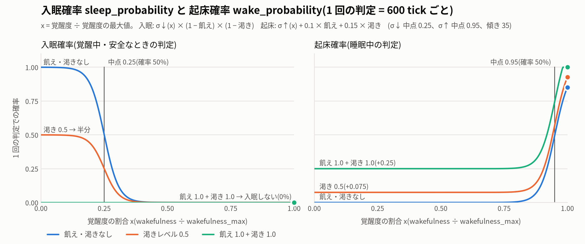

# Ecologrid: 動物の状態(睡眠・覚醒・食事可能)と個体の能力値(仕様案)

2026-11-04 作成、2026-11-05 改訂(睡眠のコアタイムの廃止、入眠確率、体力・スタミナの増減表)。作者指示(確定)と、それに基づく設計案をまとめる。**実装済み(2026-11-06、`docs/tasks/1_14`。簡略計算モード `lite` を除く)。** 現行の仕様は本書の【確定】、未実装の部分は【案】。時間はすべて tick 数(`docs/spec/time-spec.md`)。1 tick = ゲーム内の 1 秒、1 時間 = 3,600 tick、earth の 1 日 = 86,400 tick。

凡例: **【確定】** 作者指示 / **【案】** 提案(未承認)/ **【要確認】** 解釈が分かれ、判断が必要。

**この改訂の要点**: ①睡眠の**コアタイムの概念を廃止**し、睡眠を「覚醒度」と「入眠・起床の確率」だけで決める(§5)。②体力・スタミナの消費・回復を、**状態とアクションごとの増減表**にまとめた(§6)。

---

## 1. NPC の自動捕食と「食事が可能」な状態

### 1.1 規則【確定】
**NPC は、「空腹」で、かつ「食事が可能」なときに、自動で捕食する。**(従来の「接触した獲物を、空腹でなくても自動で捕食する」を置き換える。spec.md §4.4。)

- **空腹**: Energy が `hunger_threshold`(種ごと。現行 60)未満。
- **食事が可能**(`can_eat`)【確定: 条件の構成 / 案: 詳細】: 次の 3 つをすべて満たす。
  1. **意識がある**: 覚醒状態(睡眠・意識消失ではない。§4)。
  2. **体が動く**: Energy > 0(Energy 0 は移動不可。spec.md §4.3)、かつ**スタミナが食事の消費(0.025)以上**【案】。将来、麻痺・拘束・負傷などを加える(TODO G-29)。
  3. **安全な状態である**【確定: 「戦闘状態にない」を、「安全な状態である」に訂正】。
- **安全な状態**【確定】: **戦闘状態にない**、かつ **落下中でない**。
  - 戦闘状態: §7。
  - 落下中: 重力・落下は `docs/tasks/x_10` で実装する。それまでは常に「落下中でない」。
- Player は、従来どおり `eat` コマンドで食べる。**睡眠・意識消失中はコマンドを拒否する**(`reason`: `asleep` / `unconscious`)。

### 1.2 ねらい
tick 数の値に移行したシミュレーションで、触れた植物を満腹でも食べ続ける挙動が原因とみられる、草・小麦の枯渇が起きた(`docs/tasks/1_13`)。空腹のときだけ食べることで、消費が代謝に見合う量になる。

## 2. 個体の能力値

個体ごとに持つ値。

| 能力値 | 意味 | 影響するもの |
|---|---|---|
| **体力**(`max_health`、Health の最大値) | 既存の Health(ライフ)。**攻撃力・防御力には影響しない**【確定】。**覚醒度には影響しない**【確定】 | 生存、スタミナの最大値(§6) |
| **筋力**(`strength`)【確定】 | **体力とは別**の能力値。**攻撃力・防御力に影響する**【確定】。係数は種ごと【確定】 | 攻撃力、防御力(§8) |
| **精神力**(`mind`)【確定】 | **個体ごとの能力値**。**覚醒度の最大値を決める**。個体の初期精神力が決まっている【確定】 | 覚醒度の最大値(§5) |
| **スタミナ**(`stamina`)【確定】 | **体力とは別**のパラメータ。**行動で消費する**。**最大値は体力値(現在の Health)** | 行動(移動・捕食・飲水)ができるか(§6) |

### 2.1 初期値の決まり方【確定】
- **精神力は、個体ごとに初期値を持つ。**
  - **現状**: 特定の種の初期精神力は、**個体によらず、種の初期精神力で決まる**。同じ種の個体は、同じ初期精神力を持つ(個体の値は、個体の状態として保持する)。
  - **将来**: **遺伝子の概念を導入し、交配時に遺伝子によって子の精神力が決まる**(TODO G-28)。
- **筋力・体力も、現状は種の値で一定**(個体差はつけない)【確定】。
- **体力が減少していても、覚醒していられる**【確定】: 覚醒度の最大値・減少・回復・入眠と起床の確率は、体力(最大値も現在値も)を使わない。Health が低くても、覚醒度が十分なら覚醒している。

### 2.2 種の基準値と係数(暫定値)【案】
| 種 | 体力(max_health) | 筋力 | 初期精神力 | 攻撃係数 | 防御係数 | 覚醒度の最大値の係数(`wakefulness_per_mind`) |
|---|---|---|---|---|---|---|
| Player | 100 | 50 | 50 | 1.0 | 0.8 | 2.0 |
| Rabbit | 100 | 10 | 20 | 0.5 | 0.3 | 5.0 |
| Fox | 100 | 35 | 25 | 1.2 | 0.6 | 4.0 |

- 覚醒度の最大値(`wakefulness_max`)= 精神力 × `wakefulness_per_mind`。基準では全種 100(Player 50×2.0、Rabbit 20×5.0、Fox 25×4.0)。
- 攻撃力 = 筋力 × 攻撃係数(Player 50、Rabbit 5、Fox 42)、防御力 = 筋力 × 防御係数(Player 40、Rabbit 3、Fox 21)。

## 3. 名前【確定】

| 値 | 名前 |
|---|---|
| 覚醒度(現在値 / 最大値) | `wakefulness` / `wakefulness_max` |
| 覚醒中の毎 tick の減少(種ごと。**行動によらず一定**) | `wakefulness_decay_per_tick` |
| 睡眠中の毎 tick の回復(種ごと) | `wakefulness_recovery_per_tick` |
| 意識が戻る水準(最大値に対する割合) | `consciousness_regain_level` |
| 入眠圧 / 入眠確率 | `sleep_pressure` / `min(1, sleep_probability_gain × sleep_pressure ^ sleep_pressure_exponent)`(1 以上は必ず入眠) |
| 睡眠周期(種)・周期要素の振幅(種) | `sleep_cycle_ticks`(earth 動物 86,400)、`sleep_cycle_amplitude` |
| 直近 5 回の入眠 tick(個体)・直近の入眠時刻 | `sleep_onset_history`、`sleep_peak_tick` |
| 睡眠リズム係数(0〜1)【確定】 | `sleep_rhythm` |
| 標準入眠時刻・標準の睡眠時間(種) | `sleep_standard_onset_tick`、`sleep_standard_duration_ticks` |
| 簡略計算モード・睡眠の簡略方式 | `sim_detail`(`full` / `lite`)、`scheduled_sleep`(定刻睡眠) |
| 起床確率 | `wake_probability`(個体の値: `wake_midpoint`、`wake_steepness`) |
| 睡眠・覚醒の判定の間隔 | `sleep_check_interval_ticks` |
| 飢え・渇きのレベル(0〜1) | `hunger_level`、`thirst_level` |
| 起床確率に加える飢え・渇きの重み(定数) | `wake_hunger_weight`、`wake_thirst_weight` |
| スタミナ(現在値 / 最大値) | `stamina` / `stamina_max`(= `health`) |
| スタミナの消費(アクションごと) | `stamina_cost_move`、`stamina_cost_eat`、`stamina_cost_drink` |

(`wakefulness` と `wake_probability` は 作者承認済み。入眠圧 `sleep_pressure` は 作者指示 2026-11-05。`sleep_rhythm` は名前の提案。)

## 4. 動物の状態

動物(Rabbit / Fox / Player)は、次のいずれかの状態にある。

| 状態 | 意味 | 行動 | 食事 |
|---|---|---|---|
| **覚醒**(`awake`) | 意識があり、行動できる。「休憩」(§6.2)は覚醒したままのアクション | できる | `can_eat` を満たせば可能 |
| **睡眠**(`sleeping`) | 眠っている。覚醒度・体力・スタミナが回復する。起床は確率的に決まる(§5.3) | できない | できない |
| **意識消失**(`unconscious`) | 覚醒度が 0 になり、強制的に眠っている(§5.4) | できない | できない |

- **Player も、睡眠・覚醒度の対象**【確定】。サーバ設定で、Player の睡眠を無効にできる【案】。
- 眠っている間(睡眠・意識消失)は、移動・飲水・捕食・コマンド(Player)ができない。代謝は続く。

## 5. 睡眠と覚醒度(コアタイムなし)

### 5.0 睡眠のコアタイムの廃止【確定】
**睡眠のコアタイム(1 日の中の就寝・起床の時間帯)の概念を廃止する。** 睡眠は、**覚醒度**と、**入眠・起床の確率**だけで決まる。これにより、睡眠の計算が単純になる:
- 睡眠は、日の時刻(惑星の時計・`day_length_ticks`)に依存しない。入眠の時刻・コアの長さ・前後の余裕・起床後の再入眠の禁止などの規則は不要になる。
- 起きている間に覚醒度が下がり、**下がるほど眠りやすくなる**。眠っている間に覚醒度が上がり、**上がるほど起きやすくなる**。この 2 つの確率が、睡眠と覚醒の周期を作る。

### 5.1 覚醒度(`wakefulness`)【確定: 方針 / 案: 数値】
- **最大値は精神力で決まる**: `wakefulness_max = mind × wakefulness_per_mind`。体力は関与しない(§2.1)。
- **覚醒している間、毎 tick 一定量が減る**【確定: 行動によらず一定】: `wakefulness_decay_per_tick`(種ごと)。休憩中も減る(休憩は覚醒したまま)。**行動による消費は、別のパラメータであるスタミナ(§6)が受け持つ**。
- **睡眠状態(睡眠・意識消失)の 1 tick ごとに、種ごとの係数 `wakefulness_recovery_per_tick` だけ回復**する【確定】。最大値で頭打ち。
- 以下、`x = wakefulness ÷ wakefulness_max`(覚醒度の割合。0〜1)。

### 5.2 入眠圧(`sleep_pressure`)と入眠【確定: 方針(作者 2026-11-05)/ 案: 詳細・数値】

**方針**【確定】
- **覚醒度が低下すると、入眠しやすくなる。** 入眠しやすさのパラメータを**入眠圧**(`sleep_pressure`)と定義する。
- **覚醒度が 0 になる前に、入眠圧により、確率的に、本人の意思に関係なく、睡眠状態に移行する**。
- **入眠圧 = (1 − 覚醒度の割合) + 睡眠周期要素**。**入眠確率 = `sleep_probability_gain × 入眠圧^n`**(係数とべき指数 `sleep_pressure_exponent`。下記)。**入眠圧が 1 以上か未満かによらず同じ式**で、**入眠確率が 1 以上になったときは、必ず入眠する**(作者 2026-11-06)。
- (旧案の、右下がりのシグモイド関数 `σ↓(x)`・`sleep_midpoint`・`sleep_steepness` は廃止。)

**いつ判定するか**: 覚醒していて、**安全な状態**(§1.1: 戦闘状態でない・落下中でない)の個体を、`sleep_check_interval_ticks`(標準 600 tick = ゲーム内の 10 分)ごとに判定する。安全でないときは入眠しない。

**式**
```
x                = wakefulness ÷ wakefulness_max            (覚醒度の割合。0〜1)
sleep_cycle_term = sleep_cycle_amplitude × sleep_rhythm      (睡眠周期要素)
sleep_pressure   = wakefulness_pressure_gain × (1 − x)
                 + cycle_pressure_gain × sleep_cycle_term    (入眠圧)
入眠確率         = min(1, sleep_probability_gain × sleep_pressure ^ sleep_pressure_exponent)
                                                             (1 以上になったら必ず入眠)
```
- **`sleep_pressure_exponent`(n)**【確定: 導入(作者 2026-11-06)/ 案: 値】: 入眠圧を確率に換算するべき指数。**暫定 20(全種)**。係数 1.0・n = 1 なら入眠圧そのものが確率。n が大きいほど、入眠圧が 1 に近づくまでほとんど入眠しない(理由は下記「確率への換算」)。
- **`sleep_probability_gain`(入眠確率の係数)**【確定: 導入・掛け方・値(作者 2026-11-06)】: 入眠圧^n に掛ける係数(種ごとの定数)。**0.1(全種)**。入眠圧が 1 以上か未満かによらず掛ける。**`sleep_probability_gain × 入眠圧^n` が 1 以上になる入眠圧(= (1 ÷ 係数)^(1 ÷ n)。係数 0.1・n = 20 なら 1.122)以上で、必ず入眠する**。入眠圧が 1.0 のときの入眠確率は 10%(判定 1 回あたり)。係数を小さくするほど、起きている時間が長くなる。周期のずれ(下記)の調整に使う。係数 1.0 は、係数なしと同じ。
- `wakefulness_pressure_gain`・`cycle_pressure_gain`: 2 つの要素の調整用の係数。**当面は 1.0**(将来、バランス調整に使う。作者指示)。
- 覚醒度が 0 になった場合(入眠確率が 1 未満のまま 0 になる、入眠が禁じられる安全でない状態、飢え・渇きで入眠圧が抑えられるなど)は、従来どおり意識消失(§5.4)。係数 0.1 では、頂点の反対側(`sleep_rhythm` = 0)で覚醒度が 0 に近づくと入眠圧が 1.0(確率 10%)にとどまり、**まれに(入眠のおよそ 1 回に 1% 程度。簡易モンテカルロ)入眠する前に意識消失する**。
- **飢え・渇きの扱い【案・要確認】**: 旧案どおり、`sleep_pressure` に `(1 − hunger_level) × (1 − thirst_level)` を掛けて、生存に必要な行動(食べる・飲む)を優先する。深刻な飢え・渇きでは入眠圧が 0 になり、眠らない(覚醒度が 0 になれば意識消失)。

#### 睡眠周期要素

**種ごとの標準入眠周期**【確定】: `sleep_cycle_ticks`(種ごとのパラメータ。tick 数で定義)。**地球上の動物(Player・Rabbit・Fox)は 1 日 = 86,400 tick**。惑星の `day_length_ticks` や時計には依存しない(tick 数で持つ。§5.7)。

**個体ごとの記録**【確定】: 直近の入眠の tick を、**直近 5 回分**記録する(`sleep_onset_history`。絶対 tick。個体のデータ。ワールドの保存・スナップショットに含める)。

**直近の入眠時刻(`sleep_peak_tick`)の求め方**【確定】
1. 各記録の tick を `sleep_cycle_ticks` で割った余り(周期内の位置)にする。
2. その余りを、**ゲーム内 1 時間(3,600 tick)に丸める**(四捨五入。`(余り + 1,800) ÷ 3,600`(整数除算)を、時間の区画の数 `⌈sleep_cycle_ticks ÷ 3,600⌉`(earth: 24)で割った余り。0 時と 24 時は同じ区画)。
3. 丸めた値の**最頻値**を、直近の入眠時刻とする(`sleep_peak_tick = 区画 × 3,600`)。**最頻値が複数あるときは、その中で最も新しい記録の区画**を採る。
- 平均でなく最頻値なので、0 時をまたぐ入眠時刻(23 時台と 0 時台)を平均して昼の 12 時になる問題が起きない。また、1 回だけ外れた入眠(強制的な昼寝など)に引きずられない。

**睡眠リズム係数 `sleep_rhythm`**(0〜1)【確定: 形 / 案: 名前】
```
sleep_rhythm = ( 1 + cos( 2π × ( (tick mod sleep_cycle_ticks) − sleep_peak_tick ) ÷ sleep_cycle_ticks ) ) ÷ 2
```
- **直近の入眠時刻を頂点(1)とする**サインカーブ(コサイン)を、0〜1 に正規化した値。頂点の反対側(周期の半分後)が 0。
- 名前の案: **`sleep_rhythm`(睡眠リズム係数)**。他の候補: `sleep_phase_factor`(睡眠位相係数)、`habit_factor`(習慣係数)。「概日(`circadian`)」は、昼夜・惑星の時計との連動(TODO G-31)を連想させるので、避けた。
- **記録がまだない個体**(生成後、最初の入眠の前)【確定: 種ごとの標準入眠時刻を使う】: `sleep_peak_tick` = **種の標準入眠時刻**(次項)。1〜4 回の記録しかない間は、あるだけの記録で最頻値を求める。

**睡眠リズム係数の名前は `sleep_rhythm`**【確定(作者 2026-11-06)】。

**睡眠周期要素 = `sleep_cycle_amplitude` × `sleep_rhythm`**【確定: 種ごとの定数を掛ける / 案: 値】。`sleep_cycle_amplitude` は種ごとの定数。**暫定 0.3(全種)**。0 にすると、周期要素のない(覚醒度だけの)入眠になる。0.3 は、頂点(いつもの入眠時刻)で、16 時間起きた頃(覚醒度の割合 約 0.25。(1 − x) = 0.75)に入眠圧が 1.05 になり、入眠確率が約 28%/判定(係数 0.1・n = 20)になる値。

#### 種ごとの標準入眠時刻(`sleep_standard_onset_tick`)【確定: 種ごとに決める / 案: 値】
- 種ごとに、標準入眠周期(`sleep_cycle_ticks`)の中の、**標準の入眠時刻**を定める。tick 数(周期内の位置。`tick mod sleep_cycle_ticks`)で持つ。**入眠の記録のない個体の `sleep_peak_tick`** と、**簡略計算モードの定刻睡眠(§5.9)の入眠時刻**に使う。あわせて、簡略計算モードの睡眠の長さ `sleep_standard_duration_ticks`(標準の睡眠時間)を定める。
- earth では、tick 0 = ゲーム内 00:00(`start_offset_ticks` = 0。`docs/spec/time-spec.md`)なので、周期内の位置 = ゲーム内の時刻の位置(惑星の時計とは無関係に tick 数で持つが、earth の時刻で換算すると下表)。

| 種 | 標準入眠時刻(earth のゲーム内の時刻) | `sleep_standard_onset_tick` | 標準の睡眠時間 `sleep_standard_duration_ticks` |
|---|---|---|---|
| Player | 22:00 | 79,200 | 28,800(8 時間) |
| Rabbit | 10:00 | 36,000 | 25,200(7 時間) |
| Fox | 08:00 | 28,800 | 28,800(8 時間) |

(暫定値。人間は夜に眠り、ウサギ・キツネは昼に眠る案。全種を同じ時刻にする案もある。3,600 の倍数にする。)

#### 入眠圧と入眠確率の例(`sleep_cycle_amplitude` = 0.3、係数 0.1、n = 20)

入眠圧:

| 覚醒度の割合 x | 周期の頂点(`sleep_rhythm` = 1) | 頂点の 6 時間前または後(0.5) | 頂点の反対側(0) |
|---|---|---|---|
| 0.9(起床直後) | 0.40 | 0.25 | 0.10 |
| 0.6 | 0.70 | 0.55 | 0.40 |
| 0.3 | 1.00 | 0.85 | 0.70 |
| 0.0 | 1.30 | 1.15 | 1.00 |

入眠圧から入眠確率(1 回の判定。係数 0.1・n = 20):

| 入眠圧 | 0.5 | 0.7 | 0.8 | 0.9 | 1.0 | 1.05 | 1.1 | 1.122 以上 |
|---|---|---|---|---|---|---|---|---|
| 入眠確率 | 0.00001% | 0.008% | 0.12% | 1.2% | 10% | 26.5% | 67.3% | **100%(必ず入眠)** |

- 覚醒度が低く、かつ、いつもの入眠時刻に近いほど、入眠しやすい。頂点の近くで覚醒度が 0.3 以下なら、入眠圧が 1.0 以上で、数回の判定のうちに入眠する。
- 頂点の反対側では、入眠圧が 1.0 を超えない(振幅 0.3 では 1.122 に届かない)ので、必ず入眠することはなく、覚醒度が 0 に近づいても入眠確率は 10% 程度にとどまる。

#### 個体ごとの値(§5.2.1)

| 項目 | 持ち主 | 現状 | 将来 |
|---|---|---|---|
| `sleep_cycle_ticks`(標準入眠周期) | 種 | 86,400(全種) | 惑星・種ごと(別の惑星の動物) |
| `sleep_cycle_amplitude` | 種 | 0.3(全種) | 遺伝子(TODO G-28) |
| `sleep_pressure_exponent`(n) | 種 | 20(全種) | — |
| `sleep_probability_gain` | 種 | **0.1**(全種) | — |
| `sleep_standard_onset_tick`・`sleep_standard_duration_ticks`(標準入眠時刻・標準の睡眠時間) | 種 | §5.2 の表 | 遺伝子(G-28) |
| `sleep_onset_history`(直近 5 回の入眠 tick) | **個体** | 空で生成(`sleep_peak_tick` は標準入眠時刻) | — |
| `sleep_peak_tick`(直近の入眠時刻) | 個体(記録から導出) | — | — |
| `wake_midpoint`・`wake_steepness`(§5.3) | 個体(現状は種の定数) | 0.95 / 35 | 遺伝子(G-28) |

- 検証(起動時): `sleep_cycle_ticks` は 3,600 の倍数を推奨(それ以外は警告。丸めの区画が端数になる)。`sleep_cycle_amplitude` は 0〜1。`sleep_pressure_exponent` は 1 以上。`sleep_probability_gain` は 0 より大きい(1 以下を推奨)。`sleep_standard_onset_tick` は 0 以上 `sleep_cycle_ticks` 未満で、3,600 の倍数を推奨。`sleep_standard_duration_ticks` は 0 より大きく、`sleep_cycle_ticks` 未満。
- 判定の乱数は、ワールドの seed から決定論的に作る(再現可能)。

#### 確率への換算(べき指数と係数)と周期の安定【確定: 式 / 案: 値】
**入眠圧をそのまま 600 tick ごとの判定の確率にすると、起きている時間が短くなりすぎる**(起床直後でも入眠圧が 0.1〜0.25 あり、10 分ごとの判定を繰り返すうちに、早い時期に必ず入眠するため。期待値の計算で約 0.9 時間)。そこで、べき指数 n(= 20)と係数(= 0.1)で換算する(`入眠確率 = min(1, 0.1 × 入眠圧^20)`)。

**周期のずれ**: 入眠は、リズムの頂点の近くで起きる。起きている時間と眠る時間の合計(入眠から次の入眠まで)が 24 時間とずれると、入眠時刻が毎日ずれていく(頂点が直近の入眠時刻に追従するため)。**入眠時刻が毎日ずれないよう、覚醒度の減少の速さを調整する。**

**調整(作者指示: 係数 0.1 で、覚醒度の減少を調整)**: 簡易モンテカルロ(60 個体 × 40 日。記録・最頻値・1 時間丸め・起床確率を含む。Player、起床後の覚醒度の回復 13 時間)で、覚醒度の減少の速さ(満タンから 0 になるまでの時間)ごとの周期を調べた(`sleep_probability_gain` = 0.1、n = 20、振幅 0.3)。

| 覚醒度の減少(満タン → 0) | 起きている時間 | 眠る時間 | 入眠から入眠まで | 入眠時刻のずれ(1 周期あたり) |
|---|---|---|---|---|
| 24 時間 | 15.4 時間 | 8.3 時間 | 23.8 時間 | − 0.24 時間(早まる) |
| **24.5 時間(採用)** | **15.7 時間** | **8.3 時間** | **24.1 時間** | **+ 0.06 時間(ほぼ 0。ばらつき ± 0.5)** |
| 25 時間 | 16.1 時間 | 8.4 時間 | 24.5 時間 | + 0.5 時間(遅れる) |
| 26 時間(旧値) | 16.8 時間 | 8.4 時間 | 25.2 時間 | + 1.1 時間(遅れる) |
| 28 時間 | 18.6 時間 | 8.6 時間 | 27.3 時間 | + 2.0 時間(遅れる) |

- **係数 0.1 では、起きている時間が長くなる(旧値 26 時間で 16.8 時間)ため、入眠時刻は毎日遅れる。ゆっくりにする(減少を遅くする)と、さらに遅れる。安定させるには、旧値より速くする(24.5 時間)**。係数 1.0 のとき(期待値の計算)は、旧値だと入眠時刻が毎日 2 時間早まり、ゆっくりにすると安定する方向だった。係数 0.1 の導入で、向きが逆になった。
- 採用した値(Player 24.5 時間・Fox 24.5 時間・Rabbit 25.5 時間。§5.6)で、睡眠の割合は 1 日の約 34%、意識消失は入眠のおよそ 1 回に 1% 程度。ばらつきがあり、個体ごとの周期は、24 時間の前後約 ± 0.5 時間。
- 安定する範囲は狭い(24〜25 時間)。n・係数・振幅・起床確率を変えたときは、覚醒度の減少を再調整する。実装時のシミュレーションで再確認する。

### 5.3 起床確率(`wake_probability`)【確定: 方針 / 案: 詳細・数値】

**いつ判定するか**: 睡眠中の個体を、`sleep_check_interval_ticks`(標準 600 tick)ごとに判定する。**1 間隔ごとに、起床するかどうかを確率的に決める**【確定】。

**確率の式**:
- `σ↑(x) = 1 ÷ (1 + exp(−wake_steepness × (x − wake_midpoint)))` ← **覚醒度を横軸とする、右上がりのシグモイド関数**【確定】
- **`wake_probability = clip₀₁( σ↑(x) + wake_hunger_weight × hunger_level + wake_thirst_weight × thirst_level )`**
  - **飢え・渇きを、シグモイド関数に、定数(重み)としてプラスする**【確定】。`wake_hunger_weight` = 0.1、`wake_thirst_weight` = 0.15(全種)。
- **起床確率は個体ごとに決まる**【確定】。`wake_midpoint`・`wake_steepness` は個体の値。現状は種の定数、将来は遺伝子で決まる。

**値(暫定)**: `wake_midpoint` = 0.95、`wake_steepness` = 35(全種共通)。1 回の判定での起床確率(飢え・渇きによる加算を除く):

| x | 0.7 以下 | 0.8 | 0.85 | 0.9 | 0.95 | 1.0 |
|---|---|---|---|---|---|---|
| 起床確率 | 0% | 0.5% | 2.9% | 14.8% | 50.0% | 85.2% |

飢え・渇きによる加算: 渇きレベル 0.5 で +7.5%、飢えレベル 1.0 + 渇きレベル 1.0 で +25%。覚醒度が低いまま(x が 0.7 以下)でも、この確率で起きる。深刻に飢えた・渇いた個体は、睡眠の途中で起きる。

**起床確率の図**(図の入眠確率の側は旧案(シグモイド)で廃止。起床確率の側だけが有効。図は実装時に作り直す):



- 睡眠の持続は、起床確率の中点(0.95)で決まる。覚醒度が 0.95 付近まで上がるまで眠り続ける。起きている時間は、入眠圧(§5.2)で決まる。
- 傾き 35 は、中点付近を比較的はっきりしたしきい値にする値(傾きを小さくすると、確率が中点から離れてもだらだら続き、覚醒度 0.7 前後で起きてしまう)。

### 5.4 意識消失(強制睡眠)【確定】
**覚醒度が 0 になると意識がなくなり、強制的に睡眠状態(意識消失)になる。** 意識消失の間は、起床の判定をしない。覚醒度が `consciousness_regain_level`(最大値の 10%)に達したら、通常の睡眠(§5.3。起床の判定あり)に移る【案】。

### 5.5 状態の遷移【案】
```
覚醒 ──(判定ごとに入眠圧で入眠。安全なとき)──▶ 睡眠 ──(判定ごとに wake_probability で起床)──▶ 覚醒
覚醒 ──(覚醒度 = 0)──▶ 意識消失 ──(覚醒度 ≥ 意識が戻る水準)──▶ 睡眠 ──(wake_probability で起床)──▶ 覚醒
```
- 睡眠中の外からの刺激(攻撃・ダメージ)による起床は将来(TODO G-27)。

### 5.6 種ごとの値(暫定値)と試算【案】
| 種 | 覚醒度の減少(満タン → 0) | 減少/tick | 回復(0 → 満タン) | 回復/tick |
|---|---|---|---|---|
| Player | 88,200 tick(24 時間 30 分) | 0.001134 | 46,800 tick(13 時間) | 0.002137 |
| Rabbit | 91,800 tick(25 時間 30 分) | 0.001089 | 41,400 tick(11 時間 30 分) | 0.002415 |
| Fox | 88,200 tick(24 時間 30 分) | 0.001134 | 46,800 tick(13 時間) | 0.002137 |

(覚醒度は最大 100 の尺度。減少は覚醒中の一定の率、回復は睡眠中の率。)

- 判定の間隔 `sleep_check_interval_ticks` = 600、`consciousness_regain_level` = 0.1。
- **初期の覚醒度**【案】: 個体の生成時に、最大値の 30〜100% の一様乱数(決定論的)。個体の周期がそろって、全員が同時に眠ることを避ける。

**確率過程の試算**: 旧案(シグモイドの入眠確率)での試算は無効。入眠圧の案(係数 0.1・n = 20・振幅 0.3)での簡易モンテカルロの結果は、§5.2「確率への換算」。採用した値(Player・Fox: 起きている約 15.7 時間・眠る約 8.3 時間・入眠から入眠まで約 24.1 時間、眠っている割合 約 34%)。起床側(§5.3)は変更なし。
- 睡眠が約 8 時間続くのは、起床確率が覚醒度 0.9 以上でなければ小さいため。

### 5.7 コアタイム廃止の影響【案】
- **昼夜と睡眠の関係は、当面ない**: 睡眠は、惑星の時計・日の長さ(`day_length_ticks`)に依存しない。**個体ごとの習慣的な周期(`sleep_cycle_ticks`、地球の動物は 86,400 tick)と、直近の入眠時刻**で決まる。個体の周期は、絶対 tick の周期内の位置で決めるので、ゲーム内の時刻(惑星の `start_offset_ticks` など)とは無関係。日没・日の出と同期した睡眠、夜行性・昼行性は、将来の概日リズム(TODO G-31)。
- **個体の周期がそろわない**: 初期の覚醒度を散らす(§5.6)ので、全員が同時に眠ることはない。入眠時刻の最頻値で、個体ごとのリズムが決まる。遺伝子の導入後(G-28)は、周期・振幅も個体差になる。

### 5.8 旧案の廃止(記録)
- シグモイドの入眠確率(`sleep_midpoint`・`sleep_steepness`)は、**入眠圧(§5.2)に置き換えて廃止**(作者 2026-11-05)。「入眠確率 = 1 − 起床確率」の案は、ヒステリシスがなくなり、短い仮眠の連続になるため採らない(意見として提示済み)。

### 5.9 簡略計算モード(`lite`)と定刻睡眠(`scheduled_sleep`)【確定: 方針(作者 2026-11-06)/ 案: 詳細・実装は将来】

**趣旨**: サーバの負荷を軽減するため、**プレーヤーから一定以上離れた Region では、計算を簡略化する**モードを、将来追加する。通常の計算(§5.1〜§5.4。覚醒度の増減・入眠圧・確率判定・入眠の記録)に対し、簡略な計算にする。

**命名**【案】
- **簡略計算モード = `lite`(簡略モード)**。対になる通常の計算は **`full`**。Region ごとの属性 `sim_detail`(`full` / `lite`)で表す(シミュレーションの詳細度。LOD)。どちらにするかは、最も近い Player からの Region 数の距離で決める(`lite_distance_regions`。値と判定は別途定義)。
- **睡眠の簡略計算の方式 = 「定刻睡眠」(`scheduled_sleep`)**。ほかの候補: `fixed_schedule_sleep`、`timetable_sleep`。

**定刻睡眠の計算(`lite` モードの睡眠)**【確定: 種ごとの標準入眠時刻で入眠する単純計算】
- 個体が睡眠中かどうかを、**絶対 tick だけから決める**: `睡眠中 = ((tick − sleep_standard_onset_tick) mod sleep_cycle_ticks) < sleep_standard_duration_ticks`。種ごとの標準入眠時刻に入眠し、標準の睡眠時間で起床する(§5.2)。
- 覚醒度の増減・入眠圧・確率の判定・入眠の記録・飢え・渇きによる入眠の抑制は、**計算しない**(個体ごとの毎回の判定が不要。O(1))。植物の遅延評価(`plant_cycle`)と同様に、必要なときに(状態を見たときに)評価する。
- 睡眠中の個体は、`full` と同じく、移動・飲水・捕食などをしない(`lite` モードの他の行動の簡略化は別途。TODO G-33)。

**`lite` → `full` に戻るとき(プレーヤーが近づいたとき)**【案】: 状態の食い違いをなくすため、定刻のスケジュールから個体の状態を復元する。
- 睡眠・覚醒の状態: スケジュールどおり。
- 覚醒度: 覚醒中 = `起床時の覚醒度(0.9) − 減少/tick × 起床からの tick`(下限 0.05)、睡眠中 = `入眠時の覚醒度 + 回復/tick × 入眠からの tick`(入眠時の覚醒度 = 0.9 − 減少/tick × 起きている時間。Player で約 0.247)。
- `sleep_onset_history`: スケジュール上の直近 5 回の入眠 tick で埋める。`sleep_peak_tick` は標準入眠時刻。
- `full` → `lite` に切り替わるときは、状態をスケジュールどおりに合わせる(離れているので、見た目の飛びは問題にならない)。

## 6. 体力・スタミナの増減表

### 6.1 スタミナ(`stamina`)【確定】
- **スタミナは、体力とは別のパラメータで、行動によって消費する**【確定】。覚醒度は行動で減らない(§5.1)。
- **最大値は体力値(現在の Health)**【確定】: `stamina_max = health`。体力が全快(`max_health`)のときは、体力もスタミナも `max_health` まで回復しうる。**体力が減っていると、スタミナもその体力値までしか回復しない**。体力が下がれば、スタミナもその値に切り詰められる(常に `stamina ≤ health`)。
- **回復は体力と同じ状態のとき、速さは体力の 10 倍**【確定】。

### 6.2 休憩(`rest`)【確定: アクションとして定義 / 案: 詳細】
- **休憩は、アクション(`rest`)として定義する**【確定】。**睡眠中だけでなく、休憩中にも、体力とスタミナが回復する**【確定】。
- 休憩中は、覚醒したまま(意識がある)。移動・飲水・捕食をしない(始めると休憩が終わる)。覚醒度は回復せず、減り続ける(回復するのは睡眠だけ)【案】。
- Player: コマンド `rest` で始め、別のコマンドで終える【案】。NPC: 安全で、スタミナまたは体力が低いとき(しきい値は種ごと)に休憩し、満タンになるか、空腹・渇きなどで終える【案】。安全でないとき(戦闘状態・落下中)は休憩に入らない/終える【案】。

### 6.3 状態による増減(毎 tick)【確定: 方針 / 案: 数値】
体力・スタミナ・覚醒度の増減を、**状態ごと**にまとめる。数値は Player の値(100 を最大とした尺度)。種ごとの値は §6.6。「+」は増加、「−」は減少、「0」は変化なし。

| 状態 | 体力 | スタミナ | 覚醒度 | 水分 | Energy |
|---|---|---|---|---|---|
| **動作中**(覚醒。直近 `idle_after_ticks` 以内に行動した) | 0 | **− 気温の消費**(§6.9)。行動ごとにも消費(§6.4)。回復なし | − 0.001134 | **− 気温で決まる**(§6.9) | − 一定 |
| **静止**(覚醒。`idle_after_ticks` 以上行動していない) | + 0.000772 | + 0.007716(体力の 10 倍)**− 気温の消費** | − 0.001134 | − 気温で決まる | − 一定 |
| **休憩**(`rest`) | + 0.003472 | + 0.034722(体力の 10 倍)**− 気温の消費** | − 0.001134 | − 気温で決まる | − 一定 |
| **睡眠** | + 0.003472 | + 0.034722(体力の 10 倍)**− 気温の消費** | + 0.002137 | − 気温で決まる | − 一定 |
| **意識消失** | + 0.003472 | + 0.034722(体力の 10 倍)**− 気温の消費** | + 0.002137 | − 気温で決まる | − 一定 |
| **欠乏**(水分 0 または Energy 0。他の状態に重なる) | − 0.003086(欠乏 1 つあたり。両方なら − 0.006173) | 回復は 0(気温の消費・行動の消費のみ) | (重なる状態に従う) | 0 で止まる | 0 で止まる |

- 水分・Energy は、表の数値(100 を最大とした尺度)でなく、種ごとの tick 数(§6.9・species.py)で決まる。**水分の消費は、気温によるものだけ**(行動・状態では変わらない)。Energy の消費は一定(気温への依存は将来。TODO G-32)。

- **回復は、欠乏のときは止まる**(体力・スタミナとも)。欠乏の間は、体力が減る。
- `idle_after_ticks`(静止とみなすまでの行動のない tick 数)= 60 tick(ゲーム内の 1 分)【案】。行動し続けている間(Player が歩き続けるなど)は「動作中」で、回復しない。
- 各状態の回復の速さ(0 → 100 に要する時間。**気温の消費(§6.9)を引く前の値**。快適な気温(§6.9)のときは、そのまま):

| 状態 | 体力 | スタミナ |
|---|---|---|
| 静止 | 129,600 tick(1 日 12 時間) | 12,960 tick(3 時間 36 分) |
| 休憩・睡眠・意識消失(Player / Fox) | 28,800 tick(8 時間) | 2,880 tick(48 分) |
| 休憩・睡眠・意識消失(Rabbit) | 25,200 tick(7 時間) | 2,520 tick(42 分) |
| 欠乏による体力の減少(1 つあたり) | 32,400 tick(9 時間)で 100 → 0 | — |

### 6.4 アクションによる増減(1 回ごと)【確定: スタミナの消費量 / 案: 他】

| アクション | 体力 | スタミナ | 覚醒度 | 水分 | Energy | その他 |
|---|---|---|---|---|---|---|
| **移動**(1 歩) | 0 | **− 0.005** | 0 | 0 | − 歩あたりの消費(Player 0.0062、Rabbit 0.0185、Fox 0.0223) | 「動作中」になる |
| **捕食** | 0 | **− 0.025** | 0 | 0 | + 獲物の Energy × 吸収率 | 「動作中」になる |
| **飲水** | 0 | **− 0.01** | 0 | + 10(動物は + 5) | 0 | 「動作中」になる |
| **休憩の開始・終了** | 0 | 0 | 0 | 0 | 0 | 状態が「休憩」に変わる |
| 攻撃(将来) | 反作用のダメージ(`docs/tasks/x_10`) | − (未定) | 0 | 0 | 0 | 戦闘状態(§7) |
| ダメージを受ける(攻撃・落下。将来) | − ダメージ × (1 − 軽減率) | 体力値まで切り詰め | 0 | 0 | 0 | 攻撃なら戦闘状態 |

- **行動のたびに、覚醒度は減らない**(一定。§5.1)。行動の消費は、スタミナだけ。
- 行動をすると、「動作中」になり、直近 60 tick の間は、静止の回復をしない。

### 6.5 連動する規則【案】
1. **体力が変わるたび**、`stamina = min(stamina, health)`(スタミナは体力値を超えない)。
2. 回復で体力が増えると、スタミナの最大値も増える。スタミナの回復は、体力値で頭打ち。
3. 体力の回復は `max_health` で頭打ち。
4. 睡眠中の体力・スタミナが満タンになっても、睡眠は続く(睡眠は覚醒度と起床確率で終わる)。
5. 睡眠・休憩の回復は、欠乏でないときだけ。
6. **スタミナの純増減 = 回復 − 気温の消費**(§6.9)。気温の消費が回復を上回ると、静止していてもスタミナは減る。0 を下回らず、体力値(= 最大値)を超えない。

### 6.6 種ごとの値(暫定値)【案】
| 種 | 休憩・睡眠中の体力の回復(`rest_regen_full_ticks`) | 休憩・睡眠中のスタミナの回復(10 倍) | 静止中の体力の回復 | 静止中のスタミナの回復 |
|---|---|---|---|---|
| Player | 28,800 tick(0.003472/tick) | 0.034722/tick | 129,600 tick(0.000772/tick) | 0.007716/tick |
| Rabbit | 25,200 tick(0.003968/tick) | 0.039683/tick | 129,600 tick | 0.007716/tick |
| Fox | 28,800 tick(0.003472/tick) | 0.034722/tick | 129,600 tick | 0.007716/tick |

(休憩・睡眠中の体力の回復は、以前のコアタイムの長さと同じ値だが、コアタイムの概念とは無関係な、種ごとの値。)

### 6.7 スタミナが足りないとき【案】
行動の消費に足りないとき、その行動はできない(息切れ)。Player は、コマンドを拒否(`command_rejected`、`reason`: `exhausted`)。NPC は、休憩する。

### 6.8 試算: スタミナが尽きるまで【案】
連続して歩き続けた時間(動作中のため回復なし)。消費は 1 tick あたり、Player 0.001(5 tick に 0.005)、Rabbit 0.00025(20 tick)、Fox 0.000417(12 tick)。

| 体力 | Player | Rabbit | Fox |
|---|---|---|---|
| 100 | 27.8 時間 | 111.1 時間 | 66.7 時間 |
| 50 | 13.9 時間 | 55.6 時間 | 33.3 時間 |
| 20 | 5.6 時間 | 22.2 時間 | 13.3 時間 |
| 10 | 2.8 時間 | 11.1 時間 | 6.7 時間 |

- 提案の消費量では、体力が全快なら、スタミナは連続歩行でも 1 日以上持つ。**スタミナが効いてくるのは、体力が減ったとき**(体力 20 なら Player で 5.6 時間)。体力が低い個体ほど、すぐ息切れして休まなければならない。
- 以上は快適な気温のとき。**暑さ・寒さでは、気温の消費が加わる**(§6.9)ので、持続時間は短くなる。
- 静止(行動を 60 tick 以上しない)になると、スタミナは 10 倍の速さで回復するので、時々立ち止まる行動なら、スタミナはほぼ減らない。「動作中」が続く連続行動でだけ、スタミナが減る。

### 6.9 気温による消費【確定: 方針 / 案: 式・数値】

**水分とスタミナの消費に、気温による消費を加える。水分の消費は、気温によるものだけとする**【確定】(行動・状態では水分は減らない。基準の気温 20 ℃での消費が、現行の「一定の減少」に代わる)。

**気温の持ち方**
- **気温は、Region の惑星の属性**(`temperature_c`、単位 ℃)。earth の標準は **20 ℃で一定**(=基準の気温。現行の挙動と同じ)。サーバ・Region 内のすべての個体に同じ気温が効く。
- 日・季節・標高・天候による変動は将来(TODO G-32)。拡張のために、惑星に `temperature_amplitude_c`(1 日の変動幅。earth: 0)を予約し、`気温(tick) = temperature_c + amplitude × cos(2π × (日の位置 − 最高気温の時刻) ÷ day_length_ticks)` とする案。標準は変動幅 0。
- 気温は `/config` の `planets` に含め、世界のスナップショット(`/world/snapshot`)にも現在値を含める。CLI の状態バーに表示する。

**水分の消費**【確定: 指数関数 / 案: 係数】(作者 2026-11-05)
- 気温 T(℃)の水分の消費を、**気温の指数関数**とする。**35 ℃から急激に立ち上がり、40 ℃では 5 時間で脱水する。100 ℃以上では水分が蒸発するので、十分大きな値になる。0 ℃以下でも、一定量は減る(0 ℃で約 80 時間で脱水)**。
- **水分の消費(1 tick あたり。満タンに対する割合) = `hydration_rate_floor` + `hydration_rate_40` × exp(`hydration_temp_k` × (T − 40))`**(Player を基準とした値) × 種の係数 `hydration_rate_factor`。
  - `hydration_rate_floor` = 1 ÷ 288,000(80 時間で脱水する、一定の消費。気温が下がると、この値に近づく。**0 ℃以下の消費は、ほぼ一定**)
  - `hydration_rate_40` = 1 ÷ 19,200(40 ℃のとき、floor との合計が 1 ÷ 18,000 = 5 時間で脱水)
  - `hydration_temp_k` = 0.2(**5 ℃上がるごとに、指数の部分が約 2.7 倍(e 倍)**。35 ℃ → 40 ℃ → 45 ℃ で、12.3 時間 → 5.0 時間 → 1.9 時間)
  - 100 ℃のとき、消費は 1 tick あたり 8.5(満タンの 850%)。1 tick で水分が 0 になる(蒸発)。120 ℃以上も同様(水分は 0 を下回らない)。
- 睡眠・意識消失・休憩など、どの状態でも同じ(気温だけで決まる。行動では減らない)。
- **種の係数 `hydration_rate_factor`**【案】: Player 1.0、Rabbit・Fox 1.2(現行の、Rabbit・Fox は Player の 5/6 の時間で脱水する値を保つ)。

| 気温 | 0 ℃以下 | 10 ℃ | 20 ℃ | 30 ℃ | 35 ℃ | 40 ℃ | 45 ℃ | 50 ℃ | 60 ℃ | 80 ℃ | 100 ℃以上 |
|---|---|---|---|---|---|---|---|---|---|---|---|
| Player の水分が満タンから 0 になる時間 | 79.6〜80.0 時間 | 77.1 時間 | 62.8 時間 | 26.4 時間 | 12.3 時間 | **5.0 時間** | 1.9 時間 | 43 分 | 5.9 分 | 6.4 秒(6 tick) | 1 tick 未満 |

- **現行の値からの変更**: 20 ℃での Player の脱水は、現行の 72 時間(259,200 tick)から、**約 62.8 時間(225,929 tick)**になる。Rabbit・Fox は、60 時間から約 52.3 時間(188,274 tick)。生態系のバランスは G-2 で再調整する。
- 暑すぎる環境では、動物は水を飲み続けなければならず、水のない場所では急速に死ぬ。earth の標準は 20 ℃で一定なので、当面は気温の影響はない(気温を変えたテストと、将来の変動 G-32 で効く)。

**スタミナの消費**【案】
- 各種に**快適な気温の範囲**(`comfort_low_c`〜`comfort_high_c`)を持つ。範囲内では、気温による消費は 0。範囲を外れると、外れた度数に比例して、**毎 tick** スタミナを消費する(暑さ・寒さの両方)。
- `スタミナの減少/tick = stamina_temp_drain_per_degree × max(0, T − comfort_high_c, comfort_low_c − T)`、`stamina_temp_drain_per_degree` = 0.0005(100 を最大とした尺度、1 ℃・1 tick あたり。全種)。
- **どの状態でも消費する**(動作中・静止・休憩・睡眠・意識消失)。回復と相殺し、**スタミナの純増減 = 回復 − 気温の消費**(§6.5)。

| 種 | 快適な気温の範囲 |
|---|---|
| Player | 10 〜 30 ℃ |
| Rabbit | 5 〜 28 ℃ |
| Fox | 0 〜 28 ℃ |

(Player の例。快適な範囲を 10 ℃外れると毎 tick 0.005、20 ℃外れると 0.010 を消費する。)

| 気温(Player) | 10〜30 ℃ | 0 ℃ / 40 ℃(10 ℃外れ) | 50 ℃(20 ℃外れ) |
|---|---|---|---|
| 気温の消費/tick | 0 | 0.005 | 0.010 |
| 連続歩行で、スタミナ 100 が尽きるまで(消費 0.001 + 気温。回復なし) | 27.8 時間 | 4.6 時間 | 2.5 時間 |
| 静止中の純増減/tick(+ 0.007716 − 消費) | + 0.007716 | + 0.002716 | **− 0.002284**(100 から 0 まで 12.2 時間) |
| 休憩・睡眠中の純増減/tick(+ 0.034722 − 消費) | + 0.034722 | + 0.029722 | + 0.024722 |

- 極端な気温では、静止していてもスタミナが減る。休憩・睡眠をとれば回復する。スタミナが 0 になると息切れ(§6.7)。
- 体力への影響(熱中症・低体温によるダメージ)は、今回は含めない(スタミナと水分だけ)。将来の拡張(TODO G-32)。

## 7. 戦闘状態【確定: 定義】

**戦闘状態**は、次のいずれかのとき。

1. **こちらが攻撃している**: 攻撃のアクションが**予約に入っている**、または**処理中**である。
2. **攻撃を受けている**: 攻撃を受けたと**認識している**状態にいること。攻撃を受けた個体が覚醒していて、攻撃を受けたと認識している間(最後の被攻撃から `combat_recognition_ticks`、種ごと、暫定 300 tick = 5 分)。眠っている・意識がない間に受けた攻撃は、その時点では認識しない(刺激による起床は将来。TODO G-27)。

- 落下・飢餓・脱水によるダメージは、「攻撃」ではない(戦闘状態にしない)。
- 戦闘(攻撃のアクションの予約・処理)の仕組みは未実装(`docs/tasks/x_10`、TODO G-26)。**当面は常に「戦闘状態でない」**で、安全な状態(§1.1)の条件に含めるだけ。

## 8. 攻撃力と防御力【確定: 筋力の関与 / 案: 式】
- **攻撃力 = 筋力 × 攻撃係数、防御力 = 筋力 × 防御係数**【確定: 筋力が決め、体力は影響しない。係数は種ごと】。
- 攻撃の与えるエネルギー E(voxel-spec §6.1)は攻撃力から決まる【案】。受けるダメージの軽減は、防御力から決まる: `軽減率 = 防御力 ÷ (防御力 + 100)`(voxel-spec §6.1 の `toughness` を、防御力に置き換える案)。
- 戦闘・ダメージの実装は `docs/tasks/x_10`。ここでは能力値と式の定義のみ。

## 9. API・イベント・CLI【案】
- Entity(動物)に `state`(`awake` / `sleeping` / `unconscious`)、`resting`(休憩中か)、`wakefulness`、`wakefulness_max`、`stamina`、`stamina_max`(= `health`)、`mind`、`strength`、`max_health` を含める。
- イベント: `fell_asleep`、`woke_up`、`fainted`(意識消失)、`rest_started`、`rest_ended`。
- コマンド: `rest`(休憩。別のコマンドで終了)。
- Player のコマンドが睡眠・意識消失中なら拒否(`command_rejected`、`reason`: `asleep` / `unconscious`)。スタミナ不足の行動は `exhausted`。
- `/config` の `species` に、能力値の基準値、覚醒度・入眠確率・起床確率の係数、体力・スタミナの増減の値、快適な気温の範囲を含める。`planets` に気温(`temperature_c`、`temperature_amplitude_c`)を含める。
- CLI: 状態バーに覚醒度・スタミナと状態(`Awake` / `Resting` / `Sleeping` / `Unconscious`)を表示。眠っている他の動物は、大文字(`R`、`F`)で表示する案。`rest` のキー(案: `z`)。

## 10. 実装の影響範囲(`docs/tasks/1_14`)
- `species.py`(覚醒度・入眠確率・起床確率・スタミナ・能力値の定義)、`animal.py`(状態・覚醒度・入眠と起床の確率判定・`can_eat`・`is_safe`・スタミナ・休憩)、`ai.py`(睡眠中は考えない、空腹かつ `can_eat` で自動捕食、スタミナ不足で休憩)、`living.py`(状態ごとの体力の増減、体力が変わったときのスタミナの切り詰め、気温による水分・スタミナの消費)、`planets.py`(気温)、`player.py`(睡眠中のコマンド拒否、`rest`)、API・CLI、テスト。**コアタイムを使わないので、惑星・時計(`clock.py`)には依存しない。**
- 睡眠中の起床の判定・覚醒中の入眠の判定は、個体単位の定期アクション(entity モード)で `sleep_check_interval_ticks` ごとに行う案(spec.md §10)。
- **生態系への影響**: 睡眠で動物の活動が 1 日の約 3 割減る。空腹のときだけ捕食することで、植物の消費が減る。バランスは TODO G-2。

## 11. 確定済みと要確認(作者判断)

**確定済み**: 覚醒度の名前 `wakefulness`、起床確率の名前 `wake_probability`、覚醒に体力を使わない、筋力・体力は現状種の値で一定、覚醒度の消費は行動によらず一定、スタミナの導入(消費量・最大値 = 体力値・回復は体力の 10 倍)、休憩のアクション化、睡眠中と休憩中の体力・スタミナの回復、体力・スタミナの増減を状態・アクションに応じた表にすること、**睡眠のコアタイムの廃止**、**入眠確率 = `sleep_probability_gain`(0.1)× 入眠圧^n(1 以上は必ず入眠。入眠圧の 1 以上・未満によらず同じ式)、睡眠リズム係数の名前 `sleep_rhythm`、べき指数 `sleep_pressure_exponent`(n)の導入、記録のない個体は種ごとの標準入眠時刻を使うこと、簡略計算モードでは種ごとの標準入眠時刻で入眠する単純計算にすること**、**入眠圧による入眠(入眠圧 = (1 − 覚醒度) + 睡眠周期要素。直近 5 回の入眠時刻の最頻値(1 時間丸め)を頂点とするサインカーブ。標準入眠周期は地球の動物で 1 日)**、**水分の消費の指数関数(35 ℃から急上昇、40 ℃で 5 時間、0 ℃で約 80 時間)**、**水分とスタミナに気温による消費を加える(水分は気温による消費のみ)**。

**要確認**:
1. **覚醒度の減少の速さ**(§5.2): 作者指示は「ゆっくりに」だったが、係数 0.1 では起きている時間が長くなるため、周期を安定させるには**速くする**(Player・Fox 24.5 時間、Rabbit 25.5 時間)必要があった(旧値 26・27 時間)。この値でよいか(ゆっくりにすると、入眠時刻が毎日遅れる)。判定の間隔(600 tick)。飢え・渇きを入眠圧に掛け算する案でよいか。
2. **睡眠周期要素の値**(§5.2): `sleep_cycle_amplitude` = 0.3、最頻値が複数のときは最も新しい記録の区画を採る、意識消失も入眠の記録に含める案。**標準入眠時刻と標準の睡眠時間**(Player 22:00・8 時間、Rabbit 10:00・7 時間、Fox 08:00・8 時間。全種を同じにする案もある)。**簡略計算モードの名前**(`lite` / `full`、`sim_detail`、定刻睡眠 `scheduled_sleep`。§5.9)。
3. **増減表**(§6.3・§6.4): 状態の区分(動作中・静止・休憩・睡眠・意識消失・欠乏)と、**「動作中」と「静止」を分ける案**(`idle_after_ticks` = 60)でよいか。区分を分けず、静止の回復をなくす案(覚醒中は回復なし)もある(その場合、体力の通常の回復がなくなり、現行の挙動が変わる)。
4. 休憩中の回復の速さ(睡眠中と同じ案)と、NPC が休憩を始める・終える条件。
5. スタミナ不足のときの扱い(§6.7)。
6. 数値(暫定値。バランス調整の対象)。
7. **気温の消費**(§6.9): 気温を惑星の属性(earth は 20 ℃一定)とする案、水分の指数関数の係数(floor = 80 時間、40 ℃で 5 時間、k = 0.2 /℃。35 ℃で 12.3 時間。「35 ℃から急に」をより強くするなら k を大きくする)、種の係数(Rabbit・Fox 1.2)と 20 ℃での脱水が 72 → 62.8 時間になること、スタミナの快適範囲(Player 10〜30 ℃ など)と 0.0005/℃/tick、睡眠中も消費する案、体力への影響を含めない案。
8. 起床確率の個体ごとの値(`wake_midpoint`・`wake_steepness`)の許容範囲(中点 0.60〜0.99、傾き 10〜100)と、起床確率の図の作り直し。
